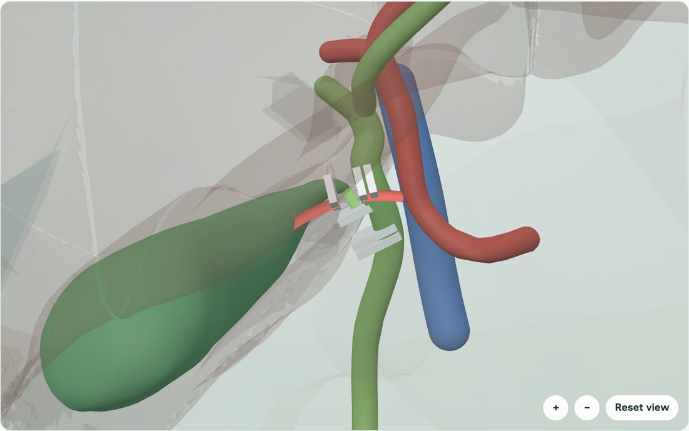
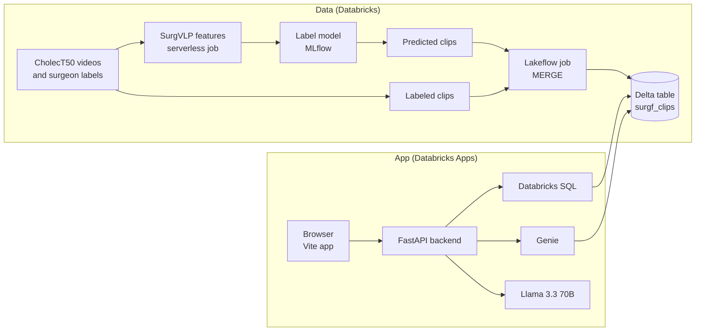
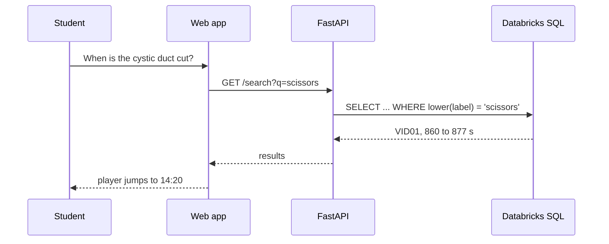
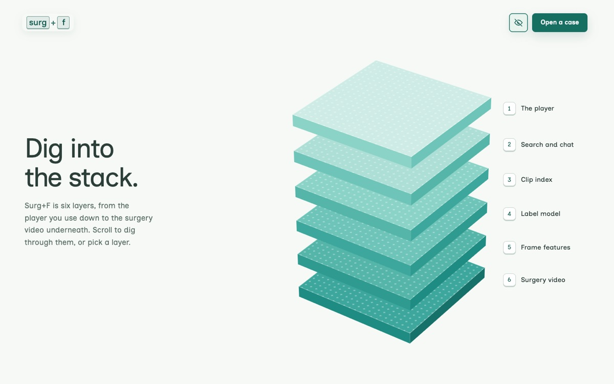

# surg+f

Search surgical videos. Ask when something happens in an operation and jump straight to that moment.

[Open the live demo](https://surg-f-7474644357435752.aws.databricksapps.com/presentation-demo)

Built at MadHacks 2026 by Aadhitya Balaji, Shlok Jadhav, Mihir Kaushal and Rohan Nuthi.

## Problem

Surgery videos are long and hard to search. VID01, one gallbladder removal from the CholecT50 dataset, is 28 minutes 53 seconds long. The part a student usually wants, the cystic duct being cut, starts at 14:20 and lasts 17 seconds. To find it, you scrub back and forth.

Every operation is also written up by hand: each step, the tools used, and when. That is slow, it has to be exact, and mistakes cause delays and billing problems.

| Who | What they need |
|---|---|
| Residents and students | Watch a step before doing it |
| Surgeons | Review a step before an operation |
| Educators | Cut the key seconds into a lesson |
| Researchers | Compare one step across many operations |

## Solution

surg+f labels every second of surgical video, so you can search it in plain words.

| Feature | What it does |
|---|---|
| Label every second | A model predicts 29 labels each second: tools, actions and anatomy |
| Ask in plain words | "When is the cystic duct cut?" becomes a search for the scissors |
| Jump to the moment | The player skips straight to the start of the clip |
| Study | Step timeline, tool chart, quiz, and Lil Doc, a chat assistant |
| Practice in 3D | A 3D model of the gallbladder area that follows the video step by step |
| Bounding boxes | Experimental boxes around the gallbladder, cystic duct and tools |

The 3D anatomy comes from BodyParts3D. The clips, cut and triangle are simple drawings we added.

## How it works

What happens when you search:

| Layer | What it does | Built with |
|---|---|---|
| Player | Plays the video, jumps to results, draws boxes | Vite, JavaScript, three.js |
| Search and chat | Finds clips and answers questions | FastAPI, Databricks SQL, Genie, Llama 3.3 70B |
| Clip index | One row for every labeled or predicted clip | Delta Lake, Lakeflow Jobs |
| Label model | Predicts 29 labels from 5 seconds of video | scikit-learn, MLflow |
| Frame features | Turns each second of video into 768 numbers | SurgVLP, PyTorch |
| Surgery video | 50 gallbladder removals | CholecT50, Cholec80 |

## Model

| | |
|---|---|
| Features | SurgVLP, a model already trained on surgical video. We use it as is |
| Classifier | A small neural network (scikit-learn) that predicts all 29 labels at once |
| Data | Trained on 42 surgeries, tuned on 3, tested on 4 it never saw |
| Clips | Short gaps (2 s or less) are filled in, and clips shorter than 2 s are dropped |
| Tracking | Every run is logged in MLflow. The demo uses run `9d18d20a` |

Scores on the 4 test surgeries (F1, from 0 to 1, higher is better):

| Tool | F1 | Action | F1 | Target | F1 |
|---|---|---|---|---|---|
| Grasper | 0.89 | Retract | 0.86 | Gallbladder | 0.88 |
| Hook | 0.83 | Dissect | 0.78 | Specimen bag | 0.75 |
| Bipolar | 0.52 | Coagulate | 0.46 | Liver | 0.51 |
| Scissors | 0.29 | Grasp | 0.40 | Omentum | 0.21 |

The average over all 29 labels is 0.34. Common labels work well, and rare ones are not reliable yet. Training on 42 surgeries instead of 12 raised scissors from 0.07 to 0.29.

The bounding boxes come from a second model, Faster R-CNN, trained further on Endoscapes. It finds the gallbladder well (0.93) and tools well (0.89 precision, 0.83 recall), but often misses the small cystic duct (0.39 recall). Tool names come from the surgeons' labels. More detail: [localization plan](ml/LOCALIZATION_PLAN.md) and [full results](frontend/public/model-evals.md).

## Databricks

| Product | How we use it |
|---|---|
| Unity Catalog Volumes | Stores the features, labels, models, predictions and videos |
| Serverless compute and Lakeflow Jobs | Runs feature extraction, training, tuning, testing and export |
| MLflow | Logs every training run and score |
| Delta Lake | Holds one clip table, `workspace.default.surgf_clips` |
| Lakeflow job `surgf-import-clips` | Loads new clips with MERGE, so rerunning it adds no duplicates |
| Databricks SQL | Runs clip search |
| Genie | Answers free-form questions about our data |
| Foundation Model APIs | Llama 3.3 70B decides how to handle each chat message |
| Databricks Apps | Hosts the app ([app.yaml](app.yaml)) |

## Repo

| Folder | What is in it |
|---|---|
| [frontend](frontend) | Web app ([design notes](frontend/docs/DESIGN.md)) |
| [backend](backend) | FastAPI service |
| [ml](ml) | Features, training, testing and boxes |
| [databricks](databricks) | SQL for the clip table, import job and Genie |
| [scripts](scripts) | Databricks job launchers |
| [shared](shared) | Data shared by the frontend and backend |
| [pitch](pitch) | Presentation and video scripts |

## Sources

| | Citation | License |
|---|---|---|
| CholecT50 | Nwoye et al., [Rendezvous](https://doi.org/10.1016/j.media.2022.102433), Medical Image Analysis 78, 2022 | CC BY-NC-SA 4.0 |
| Cholec80 | Twinanda et al., [EndoNet](https://doi.org/10.1109/TMI.2016.2593957), IEEE TMI 36(1), 2017 | CC BY-NC-SA 4.0 |
| Endoscapes | Murali et al., [Scientific Data 12, 331](https://doi.org/10.1038/s41597-025-04642-4), 2025 | CC BY-NC-SA 4.0 |
| BodyParts3D | Mitsuhashi et al., [Nucleic Acids Research 37](https://doi.org/10.1093/nar/gkn613), 2009 | CC BY 4.0 |
| SurgVLP | Yuan et al., [arXiv:2307.15220](https://arxiv.org/abs/2307.15220), Medical Image Analysis, 2025 | |
| Faster R-CNN | Ren et al., [arXiv:1506.01497](https://arxiv.org/abs/1506.01497), NeurIPS 2015 | |
| Llama 3 | Grattafiori et al., [arXiv:2407.21783](https://arxiv.org/abs/2407.21783), 2024 | |

BibTeX for each one is in the Sources section of the site.

## License

The code is under the [MIT License](LICENSE). The datasets and 3D anatomy keep their own licenses (above). CholecT50, Cholec80 and Endoscapes are for non-commercial use only.

surg+f is a study tool, not a medical device. The model's predictions are approximate, and the 3D model and quiz have not been reviewed by a doctor yet.
