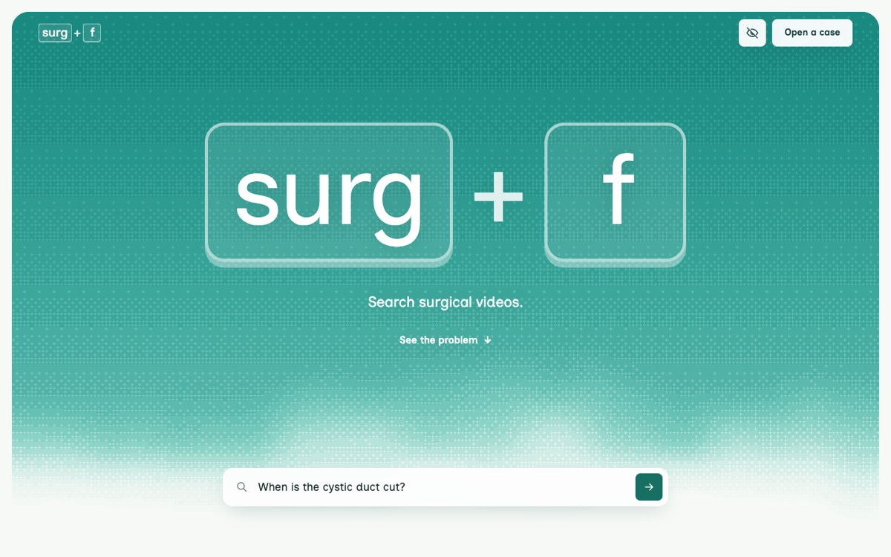
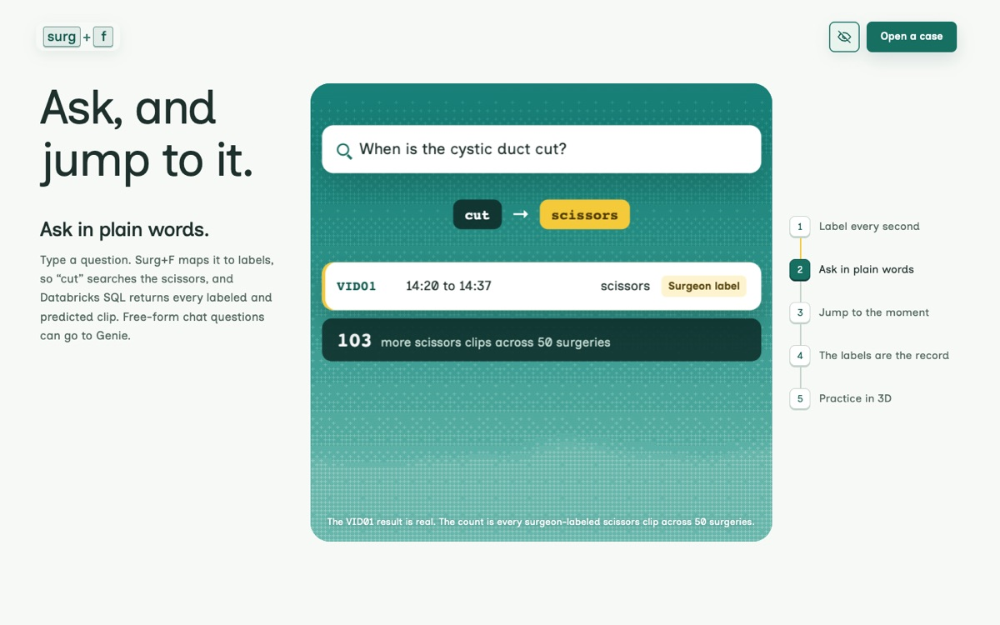
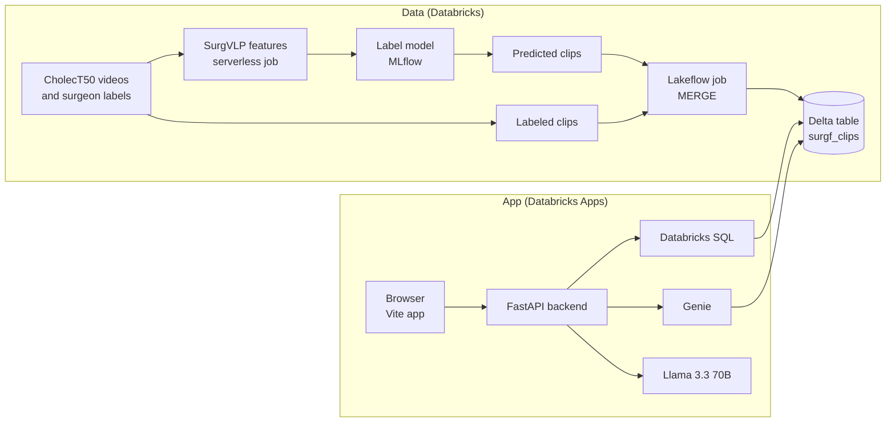
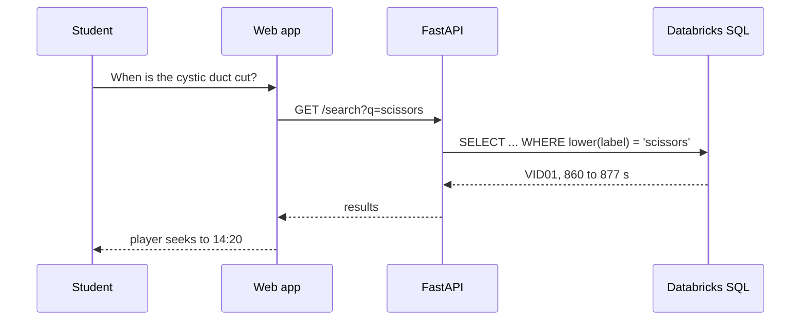
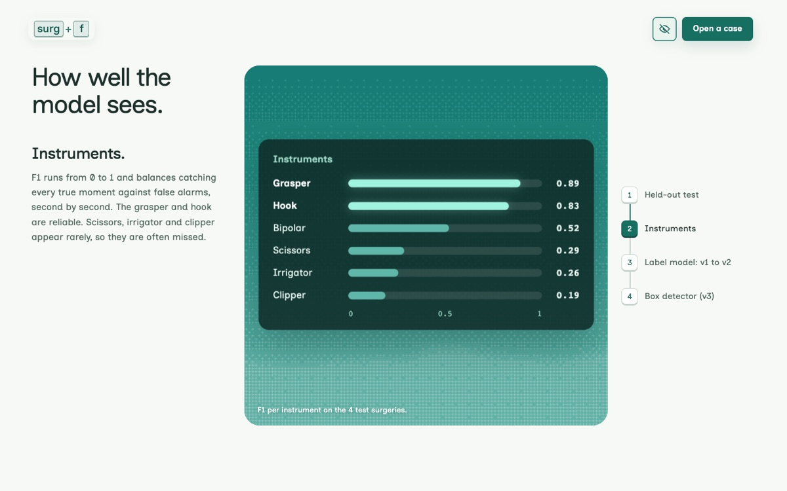
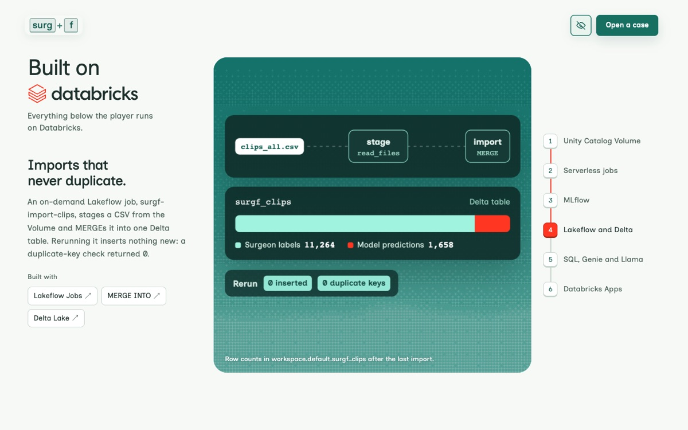

# surg+f

Search surgical videos. Ask when something happens in an operation and jump straight to that moment.

[Open the live demo](https://surg-f-7474644357435752.aws.databricksapps.com/presentation-demo)

Built at MadHacks 2026 by Aadhitya Balaji, Shlok Jadhav, Mihir Kaushal and Rohan Nuthi.



## Problem

Surgical video is long and has no index. VID01, one gallbladder removal from the CholecT50 dataset, runs 28 minutes 53 seconds. The moment a student usually needs, the cystic duct being cut, starts at 14:20 and is over 17 seconds later. Finding it means scrubbing back and forth.

Every operation is also documented by hand: each step, the instruments used, and when. That takes time, has to be exact, and gaps turn into delays and billing questions.

| Who | What they need |
|---|---|
| Residents and students | Watch one step before doing it |
| Surgeons | Review a step before a case |
| Educators | Cut the critical seconds into a lesson |
| Researchers | Compare one step across many operations |

## Solution

surg+f labels every second of surgical video and lets you search it in plain words.

| Feature | What it does |
|---|---|
| Label every second | A model predicts 29 labels per second: instruments, actions and anatomy |
| Ask in plain words | "When is the cystic duct cut?" becomes a search for the scissors |
| Jump to the moment | The player seeks straight to the clip's first second |
| Study | Step timeline, instrument chart, quiz, and Lil Doc, a chat assistant |
| Practice in 3D | A 3D model of the gallbladder region that follows the video step by step |
| Bounding boxes | Experimental boxes around the gallbladder, cystic duct and instruments |




The 3D view is built from BodyParts3D. The clips, cut and triangle are schematic drawings.

## How it works



A search, end to end:



The stack has six layers, from what you see down to the data:

| Layer | What it does | Built with |
|---|---|---|
| Player | Plays the case, seeks to results, draws boxes | Vite, plain JavaScript, three.js |
| Search and chat | Clip search, chat routing, free-form answers | FastAPI, Databricks SQL, Genie, Llama 3.3 70B |
| Clip index | One row per labeled or predicted clip | Delta Lake, Lakeflow Jobs |
| Label model | Predicts 29 labels from 5 seconds of features | scikit-learn, MLflow |
| Frame features | 768 numbers per second of video | SurgVLP (frozen), PyTorch |
| Surgery video | 50 laparoscopic gallbladder removals | CholecT50, Cholec80 |


## Model

| | |
|---|---|
| Features | SurgVLP image encoder (ResNet-50), frozen. 768 numbers per second |
| Classifier | Neural network (scikit-learn MLPClassifier), 29 labels at once, 5 seconds of context |
| Data | CholecT50: trained on 42 surgeries, tuned on 3, tested on 4 it never saw |
| Clips | Per-second predictions are smoothed: gaps of 2 s or less are filled, clips under 2 s are dropped |
| Tracking | Every run is logged in MLflow. Demo model: run `9d18d20a` |

Results on the 4 held-out surgeries (F1, 0 to 1):

| Instrument | F1 | Action | F1 | Target | F1 |
|---|---|---|---|---|---|
| Grasper | 0.89 | Retract | 0.86 | Gallbladder | 0.88 |
| Hook | 0.83 | Dissect | 0.78 | Specimen bag | 0.75 |
| Bipolar | 0.52 | Coagulate | 0.46 | Liver | 0.51 |
| Scissors | 0.29 | Grasp | 0.40 | Omentum | 0.21 |

Average across all 29 labels: 0.34. Training on 42 surgeries instead of 12 raised scissors from 0.07 to 0.29. Rare labels are not reliable yet.

Bounding boxes come from a second model, a Faster R-CNN fine-tuned on Endoscapes. On held-out frames it finds the gallbladder well (precision and recall 0.93); the small cystic duct is often missed (recall 0.39). Instruments are found well too (precision 0.89, recall 0.83 for any instrument); their names come from the surgeons' per-second labels and are shown only when exactly one instrument is listed. Accuracy on VID01 and VID02 themselves has not been measured. See the [localization plan](ml/LOCALIZATION_PLAN.md).

Full evaluation: [frontend/public/model-evals.md](frontend/public/model-evals.md).



## Databricks

| Product | How we use it |
|---|---|
| Unity Catalog Volumes | Features for all 50 surgeries, labels, models, predictions, videos |
| Serverless compute and Lakeflow Jobs | Feature extraction, training, the smoothing sweep, the final test, export |
| MLflow | Every training run, sweep setting and test score |
| Delta Lake | One clip table, `workspace.default.surgf_clips` |
| Lakeflow job `surgf-import-clips` | Stages a CSV from the Volume, then MERGEs it; reruns insert nothing new |
| Databricks SQL | Parameterized clip search |
| Genie | Free-form questions over our quiz-facts view |
| Foundation Model APIs | Llama 3.3 70B routes each chat message to a tool |
| Databricks Apps | Hosts the app ([app.yaml](app.yaml)) |



## Run it

You need Python 3.12, Node 20+, and a repo-root `.env` with the Databricks settings (ask a teammate; never commit it). Without credentials the backend serves sample data.

```sh
# backend
cd backend
python -m uv sync
python -m uv run uvicorn app.main:app --reload --port 8000

# frontend
cd frontend
npm install
npm run dev

# demo videos (needs .env)
python scripts/fetch_videos.py VID01 VID02
```

Open http://localhost:5173. Other versions of the homepage: `/demo`, `/presentation-demo`, `/video-demo`.

| Folder | What is in it |
|---|---|
| [frontend](frontend) | Web app ([README](frontend/README.md), [design notes](frontend/docs/DESIGN.md)) |
| [backend](backend) | FastAPI service ([README](backend/README.md)) |
| [ml](ml) | Features, training, evaluation, localization ([README](ml/README.md)) |
| [databricks](databricks) | SQL for the clip table, import job and Genie facts ([README](databricks/README.md)) |
| [scripts](scripts) | Databricks job launchers and checks |
| [shared](shared) | Data shared by the frontend and backend |
| [pitch](pitch) | Presentation and video scripts |
| [agent-kit](agent-kit/README.md) | Spec, contracts and team progress |

## Sources

| | Citation | License |
|---|---|---|
| CholecT50 | Nwoye et al., [Rendezvous](https://doi.org/10.1016/j.media.2022.102433), Medical Image Analysis 78, 2022 | CC BY-NC-SA 4.0 |
| Cholec80 | Twinanda et al., [EndoNet](https://doi.org/10.1109/TMI.2016.2593957), IEEE TMI 36(1), 2017 | CC BY-NC-SA 4.0 |
| Endoscapes | Murali et al., [Scientific Data 12, 331](https://doi.org/10.1038/s41597-025-04642-4), 2025 | CC BY-NC-SA 4.0 |
| BodyParts3D | Mitsuhashi et al., [Nucleic Acids Research 37](https://doi.org/10.1093/nar/gkn613), 2009 | CC BY 4.0 |
| SurgVLP | Yuan et al., [arXiv:2307.15220](https://arxiv.org/abs/2307.15220), Medical Image Analysis, 2025 | |
| Faster R-CNN | Ren et al., [arXiv:1506.01497](https://arxiv.org/abs/1506.01497), NeurIPS 2015 | |
| Llama 3 | Grattafiori et al., [arXiv:2407.21783](https://arxiv.org/abs/2407.21783), 2024 | |

BibTeX for each is in the Sources section of the site.

## License

The code is under the [MIT License](LICENSE). The datasets, the 3D anatomy and anything derived from them keep their own licenses (table above); CholecT50, Cholec80 and Endoscapes are non-commercial.

surg+f is a study aid, not a medical device. Model predictions are approximate, and the 3D model and quiz are not yet medically reviewed.
