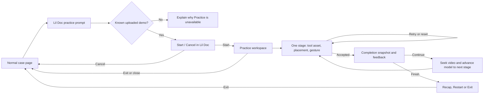

# Interactive surgery practice on the 3D model

Status (2026-11-15): delivery stages 2–3 are implemented on `feat/surgery-practice` with **draft, unreviewed content**; see [the README's Practice section](../README.md#practice-3d-surgery-practice). Stages 4–6 (clinical review, a resident usability walkthrough, and any persistence) remain open. Deviations from the proposal: the instruments are procedural three.js meshes (`asset: "procedural:<kind>"`), not GLB files, and action points are defined in the exercise as interpolations of the named model anchors, not added to the generated `manifest.json`. **Changed for the judged demo (Rohan, 2026-11-15):** the hosted VID01 case is now eligible as well as an upload of the same asset (the same file, bound by asset id and duration), and a `/practice` chat command chip sits with the other commands. The chip only fills in a Lil Doc prompt, so entry is still through Lil Doc.

Original status: proposal, not implementation. This plan keeps the current `/model` study content and interactions intact, adds a separate Practice mode, and gives all Lil Doc-created panels a close-and-reset lifecycle. The first target is one reviewed, bounded cholecystectomy exercise for the known uploaded demonstration video; it is not a general surgical simulator.

## Product goal

Let a resident ask Lil Doc to start practice for the uploaded cholecystectomy video, then complete a synchronized 3D quiz for a procedure step. The resident identifies and picks up a visible 3D instrument asset, performs the required authored interaction with it on the model, and compares the result with the matching video moment. Tool recognition and action execution must come from the interactive objects, not text fields or multiple-choice answers.

The core loop should be:

1. Prompt Lil Doc to practice a named step, such as "Let me practice clipping and cutting."
2. Lil Doc confirms that the currently uploaded video is the supported gallbladder-removal demo and offers Start / Cancel without changing the current layout or video time.
3. The resident sees one stage of the step, takes an instrument from a visual 3D tool tray, and uses it through the authored gesture on an explicit model target.
4. The exercise evaluates the instrument asset, its placement/gesture, target and sequence, then gives specific feedback and permits retry or reset.
5. On success, the resident continues to the next stage; the model advances and the video jumps to that stage's authored reference moment.
6. The resident can review the synchronized video and a short explanation of the decision at every completed stage.

The 3D scene is a generic BodyParts3D anatomy model, not patient-specific. The UI must say this before practice starts and must not imply that the exercise teaches real instrument handling, force, tissue response, or clinical competence.

### Runtime flow



The workspace has no resumable session. Close and Exit both discard it; a later Lil Doc prompt starts a new exercise from stage one.

## What exists today

- `frontend/src/model/steps.js` defines seven full schematic scenes keyed to Cholec80 phases and currently marks the step content unreviewed (`REVIEWED = false`). It provides camera views, ghosted organs, highlights, and static props.
- `frontend/src/model/viewer.js` loads one GLB using three.js, supports orbit/zoom, fades organs, animates between scenes and draws schematic ports, clips, cut, bed and bag props. It has model anchors in `frontend/src/model/manifest.json` but no editing/action API, tool meshes, raycast-to-semantic-target mapping or action history.
- `frontend/src/model/panel.js` and `frontend/src/main.js` synchronize the study model to the case video and phase list. The existing step arrows seek the video; step data comes from `/cases/{case_id}/steps`. Lil Doc currently opens this study model through `/model`; it has no Practice action or workspace-takeover state.
- `frontend/src/timeline.js` is the timeline UI. `shared/triplets.annotation.csv` contains reviewed demo-case instrument/verb/target intervals for VID01 and VID02, but this is observational video annotation. It is not 3D action ground truth and does not define safe practice actions.
- The existing anatomy and bounding-box overlays are model predictions and are not suitable as unquestioned practice scoring targets. VID01 has anatomy predictions only (gallbladder and cystic duct), not validated instrument localization.

## Scope the first release

Start with a **guided, discrete quiz exercise** for one medically reviewed step, preferably Calot triangle dissection or clipping/cutting after validating the educational objective with a surgeon. Do not start with freehand continuous tool simulation.

Proposed first exercise: given the current step, identify the cystic duct and cystic artery in the schematic model, take the correct 3D tool asset from a visual tray, insert/align it with a permitted action point, then perform the tool's authored gesture in the prescribed order. The exercise may represent grasp, apply clip, or cut as discrete events only after a medical reviewer defines the exact objective and accepts the geometry. A successful gesture changes the model state (for example, places a schematic clip at a defined anchor); a wrong tool, placement or gesture gets an explanatory hint and does not mutate the scene. This is a software interaction, not a claim of procedural validity.

For v1, include:

- One approved uploaded gallbladder-removal demonstration video, one procedure and one reviewed exercise before adding more steps.
- A short objective, physical 3D tool tray containing authored candidate assets, target prompt, stage progress and concise feedback. Tool identity is communicated by the visual asset; an optional accessible name is available on focus without becoming an answer choice. The expected tool is never pre-highlighted.
- Direct, authored tool interaction: pick up the asset, align it to a semantic target/action point, then perform a small gesture such as engage, close jaws, apply clip or cut. Do not use text entry or multiple-choice action selection.
- One action per stage. A stage completes only after its accepted interaction, then the resident explicitly continues to the next stage and its matching video moment.
- Reset the current stage, restart the exercise, pause/exit, and a clear completion state.
- Video seek/play at the relevant annotated interval with explicit video/model synchronization controls.
- Entry through a Lil Doc prompt only; no practice button, direct route or automatic mode change.
- Eligibility only for the known uploaded demo asset. Other hosted cases, arbitrary local uploads and missing video show an unavailable explanation and leave the current study workspace intact.
- Desktop first, with keyboard and touch support; responsive layout remains usable on small screens.

Defer haptics, tissue deformation, cutting physics, force feedback, unrestricted tool paths, multi-user scores, automatic pose scoring, live model inference and case-specific patient anatomy.

## Proposed experience and interaction rules

### Practice layout

- Practice is a workspace takeover, entered only from a Lil Doc practice request. It closes the timeline, chart, study-model and quiz panels while it is active.
- On desktop, retain the current Lil Doc chat area as the unchanged right column. In the content area to its left, show a compact video column on the left and the larger interactive practice model beside it. The video remains continuously visible but gives the model enough room for tool manipulation. On narrow screens, retain Lil Doc and let the resident switch between the video and practice surface without losing the active stage.
- The current `/model` experience remains Study mode and keeps its current model behavior. Practice is not exposed as a visible mode switch: Lil Doc resolves the prompt to an eligible authored exercise and starts it, or explains why it cannot start.
- Start creates a new workspace at stage one and seeks the video to stage one's authored reference time. Cancel does neither.
- In the practice panel show: step name, one-sentence objective, current stage instruction, physical tool tray, target prompt, stage progress, and Reset stage / Restart practice / Exit / Continue controls. Do not show a list of text action answers.
- Keep model labels and target callouts visible without covering the relevant anatomy. Provide a legend and reset camera button.
- Show a compact shared time display and reference-moment control inside the practice workspace. The ordinary timeline remains closed. Normal video playback must not silently change the exercise action or answer.

### Close and reset behavior

- Give Practice, Study model, chart and quiz panels a visible close control. Closing hides/unmounts that experience, discards its transient state and restores the ordinary case-page layout with the current video still loaded.
- Closing Practice discards the current stage, selected tool, model mutations, feedback and action history. Re-prompting Lil Doc creates a new practice session from stage one; it never resumes a half-finished session.
- Closing the model, chart or quiz similarly clears its temporary UI state. Lil Doc is the only way to recreate any of these assistant-opened experiences, so the normal page remains uncluttered.
- Exit and Restart are distinct: Exit closes Practice and resets to the ordinary layout; Restart stays in Practice and returns the exercise to its first stage.

### Lil Doc entry and video eligibility

- Add a dedicated Lil Doc intent, for example `practice`, with an optional authored `step_key`. Support natural prompts such as "practice the clipping step" and a clear fallback when the requested step is not authored.
- The intent handler validates that a local upload is present and matches the designated cholecystectomy demonstration asset/version before opening Practice. For this demo, the supported asset and its step-to-time mappings are authored in advance; no automatic analysis of the upload determines the exercise.
- The initial practice catalog is deliberately scoped to that asset. A resident cannot launch an exercise for a different hosted case, a different upload or a video with unknown duration/timebase.
- Lil Doc's confirmation names the selected step and provides Start / Cancel affordances in the chat response. Starting begins the takeover; cancelling leaves every current panel and video state untouched.

### Tool selection and placement

- The exercise definition lists each tool's stable ID, visual mesh, readable accessible name and supported gesture. Each stage separately declares its authored candidate tool tray and its one expected tool/gesture. Do not infer the expected tool or action from overlay detections.
- Present tools as recognizable 3D assets in a tray. The resident takes one into the model, where it is rendered at the port/working area and follows a constrained pointer or touch interaction. A tool label is available for accessibility after focus, but it is not presented as a multiple-choice answer.
- Use named semantic targets and authored anchors, not raw triangle IDs or guessed bounding-box centers. Raycast the GLB, resolve the hit to a stable semantic target, and require explicit authored action points where placement matters.
- Each stage has one accepted gesture. For example: position a grasper at its authored anchor and engage it; align the clip applier and apply a clip; align scissors and perform the cut. The gesture may be constrained to authored axes and zones so evaluation is deterministic; it must not simulate forces or tissue physics.
- After an accepted action, show the short model animation, lock a stage-completion snapshot, and enable Continue. Continue advances the model to the next authored stage and seeks the video to that stage's reference start. Invalid interactions never advance the video or mutate the anatomy.
- Provide keyboard and touch equivalents for the same physical interaction: select a focused tool asset, move it between authored placement positions, and engage its gesture. Escape returns the asset to the tray. Ensure the canvas has an accessible description and controls outside the canvas.
- No destructive or irreversible interaction; every exercise can be restarted without a network request.

### Interaction polish and quality of life

- When a resident picks up a tool, give it pointer capture and render a semi-transparent placement preview. The preview changes from neutral to a clear “ready” state inside the authored snap zone; releasing there eases the tool into its exact pose. Releasing outside returns it to the tray without penalty.
- Snap geometry is authored per stage: port/entry position, target pose, allowed approach axis, snap distance and tolerance. The constrained pose should still permit a small natural movement before it settles, so it feels like placing an instrument rather than clicking a hotspot.
- Keep camera orbit and tool manipulation separate. Dragging a selected tool manipulates it; dragging empty space or using the orbit control rotates the view. While a tool is near a valid target, keep the working area framed and avoid accidental camera movement.
- Make each tool's gesture visibly specific. Jaw tools visibly close, the clip applier visibly seats and releases a clip, and scissors visibly close through the authored cut plane. Enable the gesture control only after a valid snap, then animate the result without a page redraw or model reload.
- Give immediate, quiet state feedback: selected tool outline, target halo, snap preview, gesture-ready state, accepted-action animation and a short status message. Respect reduced-motion preferences and never make color the only signal.
- Preload the known model, candidate tool meshes and first-stage assets after Lil Doc presents Start / Cancel, without changing the page. Starting should reuse those loaded resources; later stages should preload in the background while the resident reviews the completed stage.
- Keep the video element and Lil Doc chat mounted throughout Practice. Seeking to a stage reference pauses at the intended moment and offers replay; it must not reinitialize the video, clear chat, or cause a layout shift.
- Provide safe recovery at every moment: Escape or a visible Cancel action returns the tool to the tray, Reset stage restores only the current stage, Restart returns to stage one, and Exit discards the workspace. A wrong attempt should never trap the resident in an animation or leave a partial tool state.

### Stage progression and useful learning supports

- Keep a compact stage rail showing the current stage and completed stages, without revealing future answers. Completed stages can replay their matching video moment and explanation, but cannot alter the recorded model state.
- Before a stage begins, show one clear objective and the available visual tools. The resident may orbit, zoom and inspect the 3D tool asset before committing it to the model.
- After an incorrect attempt, explain the failed constraint at the right level (tool identity, placement, gesture or target) and return the asset to a safe state. Do not disclose the correct answer immediately; offer a separate “show guidance” choice that marks the stage as guided.
- At exercise completion, show a concise stage-by-stage recap with links to replay each synchronized video moment, then offer Restart or Exit. Do not present this as a clinical proficiency score.

### Feedback and scoring

- Use transparent criteria authored for the task: correct tool asset, correct placement, correct gesture, correct semantic target, correct sequence, and any explicitly reviewed completion condition.
- Start with formative feedback (“Select the cystic duct” / “This target is not part of this action”) and a checklist, not a numeric clinical skill score.
- Show the rationale and a reference video moment after an action or on request. Keep model prediction confidence and observational labels separate from exercise correctness.
- Persist only opt-in session progress in the initial release. Avoid collecting identifiable learner performance until privacy, retention and access rules are agreed.

## Data and interface additions

### Versioned exercise definition

Add a static, versioned exercise manifest separate from `STEP_SCENES` and separate from the observational `surgf_clips`/triplet records. Keep definitions data-driven so medical review and UI can evolve independently.

Proposed shape (illustrative):

```json
{
  "schema_version": 1,
  "exercise_id": "cholecystectomy.calot.dissection.v1",
  "procedure_id": "laparoscopic_cholecystectomy",
  "eligible_video": {
    "kind": "uploaded_demo",
    "asset_id": "<designated cholecystectomy asset>",
    "duration_sec": 0,
    "fingerprint": {"bytes": 0, "sample_sha256": "<known sampled-content digest>"}
  },
  "step_key": "CalotTriangleDissection",
  "content_revision": "1.0.0",
  "model_id": "gallbladder-region",
  "model_revision": "<manifest revision or digest>",
  "review": {"status": "draft", "reviewer_role": "clinical", "reviewed_at": null},
  "objective": "<clinically reviewed objective>",
  "reference": {"case_id": "VID01", "start_sec": 0, "end_sec": 0},
  "tools": [
    {"id": "grasper", "label": "Grasper", "asset": "tools/grasper.glb", "gesture": "engage_jaws"},
    {"id": "clipper", "label": "Clip applier", "asset": "tools/clipper.glb", "gesture": "apply_clip"},
    {"id": "scissors", "label": "Scissors", "asset": "tools/scissors.glb", "gesture": "cut"}
  ],
  "targets": [{"id": "cystic_duct", "label": "Cystic duct", "anchor_ids": ["cysticDuctAtGallbladder"]}],
  "stages": [{
    "id": "stage-1",
    "instruction": "<reviewed objective>",
    "tool_tray_ids": ["grasper", "clipper", "scissors"],
    "expected_tool_id": "grasper",
    "expected_gesture": "engage_jaws",
    "target_ids": ["cystic_duct"],
    "anchor_ids": ["cysticDuctAtGallbladder"],
    "interaction": {"entry_anchor": "<port anchor>", "snap_pose_anchor": "cysticDuctAtGallbladder", "approach_axis": [0, 0, 1], "snap_distance_cm": 1.0, "gesture_control": "close_jaws"},
    "success_rule": "placement_then_gesture",
    "reference_start_sec": 0
  }]
}
```

This is a proposal: finalize names, allowed values, and clinical content with the medical reviewer before treating it as a contract. Store model-space anchors in a named, versioned model manifest. Bind the exercise to the designated uploaded asset, duration, timebase and sampled-content fingerprint; compute the fingerprint off the main UI thread and reject uploads that do not match. Use local static JSON for the first authored exercise; introduce an API only if editing, assignment, or progress synchronization requires it.

### Frontend boundaries

- Keep `steps.js` as the study visualization map; do not overload phase scenes with learner tasks, scoring or clinical instructions.
- Add a practice state/controller module that owns workspace takeover, current stage, selected tool asset, constrained placement/gesture, completion snapshot, feedback and restart/exit. Keep state transitions deterministic and independent of video rendering cadence.
- Extend `viewer.js` with a narrow interaction interface: load/render tool assets, register semantic targets and action anchors, constrain tool placement, recognize authored gestures, set valid/invalid/highlighted targets, and render/remove discrete action props. Do not expose three.js internals to the task controller.
- Keep `panel.js` focused on Study mode. Render the practice workspace from a dedicated module and route model events to the practice controller. Keep `main.js` as the integration point for Lil Doc entry, case changes, video seeking, close/reset lifecycle and page lifecycle, not as the rule engine.
- Preserve existing overlay semantics: boxes remain optional predictions on the video and never become a source of authoritative target geometry.

### Backend and persistence (later)

No backend changes are needed for a local, single-user v1 with static exercise data. Later, if residents need assignments or progress across devices, add authenticated exercise/session endpoints and a versioned attempt record. Record exercise/content/model revisions with each attempt so old scores remain interpretable. Do not write practice events into the observational triplet/clip table.

## Medical content and review gates

Before enabling a practice exercise:

1. A qualified reviewer verifies the step sequence, required tool assets, allowed gestures, target names, action points, feedback and reference clip interval.
2. Reviewers verify the generic model's orientation, relative anatomy and any simplifications used by the exercise. The current 3D steps are explicitly unreviewed; keep the notice until signed off.
3. The exercise states its intended learning objective and limitations; it must not imply patient-specific guidance or certify competence.
4. A frontend owner checks that model placement and video reference timing are understandable and do not misrepresent what the source annotations establish.
5. Record reviewer role, content revision, review date and unresolved limitations in the manifest and user-facing content.

## Delivery stages

1. **Discovery and content design:** choose the first step, learner objective, allowed tool assets/gestures, targets, success criteria and reference video range with a surgeon/educator. Bind the known uploaded demo asset, duration and timebase. Inventory current model anchors and identify missing tool meshes and anchor geometry.
2. **Interaction prototype:** load one recognizable 3D tool asset, constrain it to one semantic target with a visible snap preview, and accept one reversible gesture. Validate mouse, touch and keyboard operation, camera behavior, small-screen layout, reduced-motion behavior and smooth reuse of loaded assets. Do not score yet.
3. **Guided exercise:** add the versioned exercise manifest, Lil Doc practice intent, eligibility check, three-column workspace takeover, one-action stages, tool assets/gestures, feedback, reset/exit and stage-by-stage video seeking. Add accessible status announcements.
4. **Content validation:** obtain documented clinical review; revise or disable the exercise until approved. Compare the exercise and source clip with the actual procedural objective.
5. **Acceptance and rollout:** exercise the full loop in real browsers, verify case switches/reloads and missing video/model states, measure usability with a small resident walkthrough, and publish with educational limitations visible. Add more steps only by repeating content review and acceptance.
6. **Progress persistence (optional):** only after a product decision on accounts, privacy, retention, analytics and scoring, add an authenticated attempt API and reporting.

## Acceptance criteria for the first exercise

- A resident can enter Practice only through an eligible Lil Doc prompt and can exit back to the ordinary dashboard with the current video still loaded.
- Entering Practice closes the timeline, charts, study model and quiz. The desktop layout keeps Lil Doc unchanged at right, with compact video and the larger practice model alongside each other to its left.
- The UI identifies the model as generic and the exercise as a reviewed schematic learning activity.
- Available tools appear as recognizable interactive 3D assets, never as a text field or multiple-choice answer. The resident uses the chosen asset to carry out the authored gesture with mouse, touch or keyboard.
- Each stage accepts exactly one authored action. A valid action updates the scene and unlocks Continue; Continue moves both the model and video to the next stage. Invalid placement, target or gesture provides clear feedback without mutating state or advancing the video.
- Tool pickup, snap preview, cancellation, gesture feedback and stage transitions are visually continuous: no page re-render, blank canvas, video restart, chat reset or layout shift. Reduced-motion and keyboard/touch equivalents preserve the same interaction result.
- Exit closes and discards the Practice session. Restart reliably returns to stage one; a later Lil Doc prompt creates a fresh session.
- The reference video moment can be opened and aligned by player seconds for the exact uploaded asset; unsupported, missing or mismatched uploads do not enter Practice and receive a clear Lil Doc response.
- Step, exercise and model revisions are recorded together; no observational annotation or predicted overlay is used as practice ground truth.
- Usability review confirms a first-time resident can identify what to do next without coaching. Clinical reviewer signs off on the exact content before release.
- Automated checks cover state transitions and targeting logic; real-browser checks cover rendering, resize, keyboard/touch paths, video sync, errors and case changes.

## Ownership and coordination

The current repository workflow assigns general frontend design to Shlok and spatial data/model/player behavior to Mihir; confirm the owner for this new practice lane before implementation. Coordinate changes to `frontend/src/main.js`, case markup and shared styles. A medical educator/surgeon must own content review, while the frontend/model owner owns interaction engineering. The study-mode model should remain available while practice is developed behind a clear mode boundary.

## Open decisions

- Which one step and one learner objective should ship first?
- Which named tool assets, placement constraints and gesture sequence are medically correct for that objective?
- The first interaction uses a physical 3D tool asset with constrained placement and gesture recognition, so it can be assessed consistently.
- What exact asset identifier, duration/fingerprint and time interval bind the uploaded demo video, and who verifies synchronization/content?
- Is the first release practice-only and local, or should progress be saved? Recommendation: local session state until privacy and account requirements are defined.
- What evidence is required before displaying completion feedback, and should any scoring be shown? Recommendation: checklist feedback only in v1.
- Which browsers/devices and accessibility requirements are release blockers?
