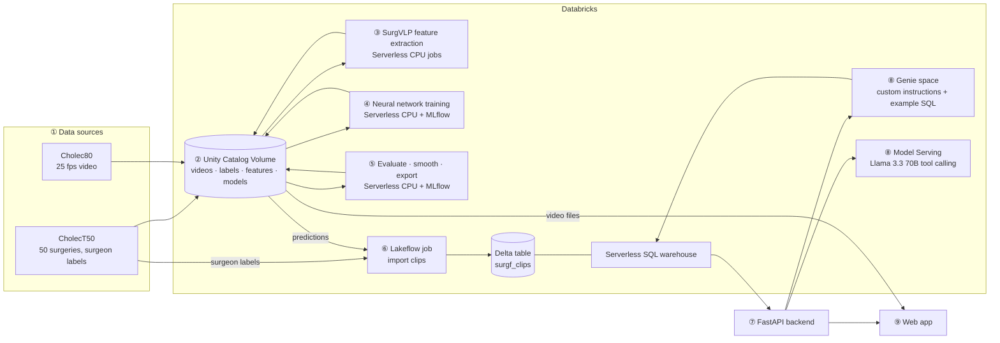

# Surg+F architecture

Surg+F lets a student search gallbladder surgery video by instrument, action or anatomy, jump to the exact moment, and ask questions in plain English. Behind it are three layers:

1. **Perception:** SurgVLP turns every second of video into features.
2. **Learning:** a neural network we trained reads those features and labels each second.
3. **Reasoning:** an assistant built on Databricks Genie answers questions about the data.

Every heavy step runs on **Databricks**.

> **Legend.** 🟧 = Databricks service. Use the stage numbers (①–⑨) as the boxes in the schematic, and the arrows in the diagram as its edges.

---

## ① Data sources

| Source | What we use | Why |
|---|---|---|
| **CholecT50** (via Hugging Face) | 50 laparoscopic cholecystectomies, sampled at 1 frame per second. Each frame is labeled by surgeons with **instruments** (6), **actions** (9) and **anatomical targets** (14). | Training data and ground truth |
| **Cholec80** | Full-quality 25 fps videos of the same surgeries, aligned to CholecT50 to within 0.1 s | Smooth playback in the app |

## ② Storage: Unity Catalog Volume 🟧

All files live in one governed Databricks Volume, `/Volumes/workspace/default/surgf/`. Nothing large is kept on laptops or in Git.

| Folder | Contents |
|---|---|
| `videos/` | Playable MP4s |
| `labels/` | Per-second labels for all 50 surgeries (29 labels) |
| `features/<surgery>/` | SurgVLP features plus a manifest, labels and a checksum file for each surgery |
| `models/` | Trained model files, copied from MLflow |
| `predictions/` | The model's clip predictions as CSV |

## ③ Feature extraction: SurgVLP on Databricks Serverless CPU 🟧

- **Model:** the SurgVLP image encoder, a ResNet-50 pretrained on surgical lecture videos. It is **frozen**: we don't retrain it.
- **Output:** a **768-number vector** per second of surgery that captures what is visible.
- **How it runs:** one serverless job per surgery, **50 in all**, up to 3 at a time.
  - Each surgery first gets a short *smoke* run that checks the setup.
  - The *full* run follows only if the smoke run passes.
  - Each job pins the exact code version and writes checksums. A bundle is accepted only when it passes validation.
- **Why serverless:** jobs start on demand and stop billing as soon as they finish. No cluster needs to be managed.

## ④ Neural network training: Serverless CPU + MLflow 🟧

- **Input:** the 768 features for a second, plus the average of the 5 seconds on either side for context.
- **Architecture:** a multilayer perceptron with one hidden layer of 256 units and **29 outputs**, one per label (6 instruments, 9 actions, 14 targets). It predicts all labels at once, so a single second can show, for example, *hook + dissect + gallbladder*.
- **Data split, by surgery:**

  | Split | Surgeries | Used for |
  |---|---|---|
  | Train | 42 | Fitting the network |
  | Validation | 3 | Choosing the settings and a confidence cutoff for each label |
  | Test | 4 | Final scoring only, never seen during training or tuning |

- **MLflow tracking** 🟧 records every run: parameters, code version, data checksums, per-label scores and the model file. The final model is MLflow run `9d18d20a`.

## ⑤ Evaluate, smooth, export: Serverless CPU + MLflow 🟧

- The model labels every second of each test surgery.
- **Smoothing** turns per-second labels into clips: gaps of up to 2 s are filled and clips shorter than 2 s are dropped. That setting won a comparison on the validation surgeries.
- Each export is scored against the surgeon labels and logged as an **MLflow child run**. The clips are written to the Volume as CSV.
- Results: see [model-evals.md](model-evals.md).

## ⑥ Clip database: Lakeflow job → Delta table 🟧

- **Lakeflow job** `surgf-import-clips` runs two SQL steps: it stages a CSV from the Volume, then **MERGE**s it into the table. Running it again never adds duplicates.
- **Delta table** `workspace.default.surgf_clips`: one row per clip, with columns `case_id, start_sec, end_sec, label, source`.
  - 11,264 surgeon-labeled clips (`annotation`)
  - 1,658 AI-predicted clips (`prediction`)
- **Serverless SQL warehouse** 🟧 answers every query from the app and from Genie. It shuts down after 10 idle minutes.

## ⑦ Backend: FastAPI

The web app's API. It reads the Delta table through the Databricks SQL connector.

| Endpoint | Powers |
|---|---|
| `GET /search?q=` | Search: "clipper", "dissect", "gallbladder" → list of clips |
| `GET /cases/{id}/timeline` | Instrument-usage chart for one video |
| `GET /cases/{id}/steps` | Surgical phases (from Cholec80 phase labels) |
| `GET /quiz` | 5-question study quiz |
| `POST /chat` | The assistant (see ⑧) |
| `GET /health` | Shows whether live Databricks data or offline fixtures are in use |

## ⑧ AI assistant: Model Serving router + custom Genie agent 🟧

A typed message goes through three layers, each a fallback for the one before it:

1. **LLM router (Databricks Model Serving 🟧):** Llama 3.3 70B Instruct, called with tool calling. It only picks a tool and its arguments, for example `search_clips("clipper")`, `instruments_together("grasper","hook")` or `rank_instruments("longest")`. The backend then runs that tool and writes the reply, so the model can't make up facts.
2. **Custom Genie agent (Databricks Genie 🟧):** answers open-ended data questions. Genie writes and runs its own SQL against `surgf_clips` on the serverless warehouse. We customized the Genie space, *Surgical Workspace Clip Manager*, with:
   - instructions about the table and synonyms (for example, *clip applier* means *clipper*)
   - rules for "when", "how long" and "together" questions
   - four verified example SQL queries
   - a guardrail that declines medical-advice questions

   The backend turns Genie's result rows back into app actions, such as jumping to a clip or drawing a chart.
3. **Keyword rules:** used whenever the model or Genie is unavailable or slow (8 s limit), so the assistant always answers.

## ⑨ Web app

- **Search bar:** results show a **Labeled** badge (surgeon) or an **AI-predicted** badge (our model). Clicking one plays the video from that second.
- **Video player:** streams the 25 fps MP4.
- **Timeline / chart:** instrument usage and surgical phases.
- **Quiz:** for studying.
- **Chat:** the assistant from ⑧.
- **Experimental overlays:** gallbladder and cystic duct boxes every 0.24 s across VID01 from a Faster R-CNN fine-tuned on Endoscapes (validation AP 0.38; gallbladder about 0.93 precision and recall, cystic duct weaker). No instrument boxes. Not yet validated on VID01 itself.

---

## Databricks touchpoints

| Databricks service | Where we use it |
|---|---|
| **Unity Catalog Volume** | All videos, labels, SurgVLP features, models and predictions (②) |
| **Serverless CPU jobs** | SurgVLP extraction for all 50 surgeries (a smoke run and a full run per surgery), model training, and evaluation and export (③④⑤) |
| **MLflow** | Experiment tracking: parameters, metrics, code version, data checksums, model files, plus a child run for each evaluation (④⑤) |
| **Lakeflow Jobs** | `surgf-import-clips`: CSV → staging → MERGE into Delta (⑥) |
| **Delta Lake table** | `surgf_clips`: the clip index behind search, charts and Genie (⑥) |
| **Serverless SQL warehouse** | Every live query from the backend and from Genie (⑥⑦⑧) |
| **Genie** | A custom Genie space that answers free-form questions with SQL (⑧) |
| **Model Serving** | Llama 3.3 70B tool-calling router for the chat box (⑧) |

## End-to-end, in one sentence

Surgery video → **SurgVLP** features (serverless) → **neural network** labels (trained and tracked in **MLflow**) → clips in a **Delta** table (loaded by **Lakeflow**) → the **FastAPI** backend and the **Genie** + **Model Serving** assistant → search, play and ask in the web app.
